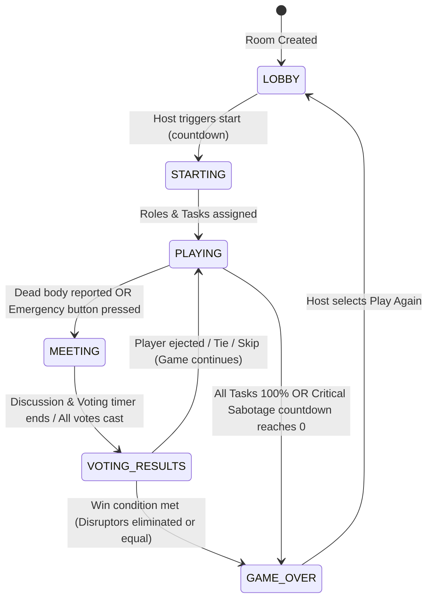

# Pressure Shift: System Architecture & Technical Specification

## 1. System Overview

**Pressure Shift** is a real-time, top-down multiplayer underwater social deduction game engineered as a modern monorepo. Set in the crushing depths of the Hadal Research Station *Nadir-7*, players are divided into research **Operators** attempting to maintain life support and covert **Disruptors** sabotaging station integrity.

```mermaid
graph TD
    Client1["Browser Client 1 (Host)<br>React 18 + Phaser 3"] <-->|Socket.IO (WSS)| Server["Authoritative Game Server<br>Node.js + Express + Socket.IO"]
    Client2["Browser Client 2 (Operator)<br>React 18 + Phaser 3"] <-->|Socket.IO (WSS)| Server
    Client3["Browser Client 3 (Disruptor)<br>React 18 + Phaser 3"] <-->|Socket.IO (WSS)| Server
    Client4["Browser Client 4 (Spectator)<br>React 18 + Phaser 3"] <-->|Socket.IO (WSS)| Server
    Server --> Shared["@pressure-shift/shared<br>Schemas, Types, State Machines"]
    Client1 --> Shared
    Client2 --> Shared
    Client3 --> Shared
    Client4 --> Shared
```

---

## 2. Monorepo Organization

```
pressure-shift/
├── packages/
│   └── shared/                 # Shared domain models, contracts, schemas & utilities
│       ├── src/
│       │   ├── types/          # Player, Room, Task, Sabotage, Meeting types
│       │   ├── schemas/        # Strict Zod schemas for all client network inputs
│       │   ├── constants/      # Physics limits, room boundaries, audio configs
│       │   └── utils/          # Pure validation, state-machine transition helpers
│       └── package.json
├── apps/
│   ├── server/                 # Authoritative game server
│   │   ├── src/
│   │   │   ├── rooms/          # In-memory RoomManager, session recovery
│   │   │   ├── engine/         # Movement validation, collision bounding, role assignment
│   │   │   ├── tasks/          # Task progression tracker & sabotage timers
│   │   │   ├── voting/         # Discussion, ballot calculation, tie-breaking, ejection
│   │   │   └── sockets/        # Socket.IO connection handlers & sanitization dispatch
│   │   └── package.json
│   └── client/                 # Client application
│       ├── src/
│       │   ├── game/           # Phaser 3 engine: Station map, lighting, collisions, sprites
│       │   ├── ui/             # React 18 HUD: Lobby, Modals, Voting, Minigames, Game Over
│       │   ├── network/        # Socket.IO typed client, reconnect logic
│       │   └── audio/          # Web Audio API procedural sound engine
│       └── package.json
├── tests/                      # Verification suite: Vitest unit/integration & Playwright E2E
├── docs/                       # Complete architecture, design, and operational manuals
└── package.json                # Monorepo workspace configuration
```

---

## 3. Authoritative Server Architecture

### 3.1 Trust Boundary & Anti-Cheat
The server retains **strict authority** over all game state:
1. **Movement & Position Verification**: Clients broadcast desired movement vectors or tick checkpoints (`player:move`). The server computes time deltas ($\Delta t$) and verifies player speed does not exceed the hydrodynamic maximum ($v \le v_{\max}$). Teleportation and boundary clipping are rejected.
2. **Proximity Gates**:
   - **Kill Command**: Verified on server: initiator must be a live Disruptor, kill cooldown must be $0$, and Euclidean distance to target must be $\le 60\text{ px}$.
   - **Task Interaction**: Player must be within interact distance ($\le 75\text{ px}$) of the target terminal coordinates.
   - **Body Report**: Dead body entity must exist and be within discovery radius ($\le 85\text{ px}$) of the reporting player.
3. **Role Data Isolation (Zero-Knowledge Payloads)**:
   - When game starts, each socket receives a personalized state sync.
   - Operators receive **no** Disruptor identities in `game:start` or `sync:state`.
   - Only Disruptors receive the array of fellow Disruptors.
   - Only after `GAME_OVER` or when role confirmation is triggered upon ejection are roles broadcasted to all participants.

### 3.2 State Machine Lifecycle



---

## 4. World & Map Design: Hadal Station Nadir-7

The facility layout consists of 9 interconnected underwater modules centered around the command hub:

| Sector ID | Sector Code | Room Name | Interactive Consoles | Primary Systems |
| :--- | :--- | :--- | :--- | :--- |
| `central_junction` | `CMD-00` | Central Dispatch | Command Table, Floor Compass | Core routing hub, domed emergency alert |
| `docking_cradle` | `SEC-01` | Submersible Docking Bay | Airlock Control, Ballast Valve | Submersible clamps, spawn staging |
| `sonar_control` | `SEC-02` | Deep Acoustic Telemetry | Sonar Calibrator, Hydrophone Grid | Active acoustic sweep, server telemetry |
| `hydroponics` | `SEC-03` | Hadal Bio-Dome Lab | Bio Sample Classifier, Algae Feeder | Photobioreactors, oxygen scrubbers |
| `pressure_lab` | `SEC-04` | Hydrostatic Testing Rig | Pressure Valve Regulator | Hyperbaric equalization, hull diagnostics |
| `thermal_plant` | `SEC-05` | Geothermal Vent Generator | Thermal Grid Router, Core Injector | Heat exchangers, volcanic energy |
| `observation_gallery`| `SEC-06`| Abyssal Trench Overlook | Optical Sensor Alignment Dial | Panoramic quartz viewport, trench search |
| `communications` | `SEC-07` | Trans-Oceanic Relay | Sub-wave Frequency Tuner | Holographic dish, blade arrays |
| `medical_bay` | `SEC-08` | Hyperbaric Cryo-Lab | Vital Scanner, Filtration Sieve | Sterile scanner beds, bio-incubators |

Corridors between sectors feature active cyan power conduits (`tile_conduit_h`, `tile_conduit_v`), precision floor demarcation hazard lines, and floor stencil signage.

---

## 5. Network Protocol & Event Matrix

### 5.1 Client to Server Events (`ClientToServerEvents`)
| Event | Payload Type | Description |
| :--- | :--- | :--- |
| `room:create` | `{ hostName, settings }` | Creates a new lobby with a unique 6-character code |
| `room:join` | `{ roomCode, playerName, cosmetic }` | Joins an existing lobby |
| `room:leave` | `{}` | Gracefully leaves room |
| `room:ready` | `{ isReady: boolean }` | Toggles player ready state |
| `room:start` | `{}` | Host initiates countdown to game start |
| `player:move` | `{ x, y, vx, vy, timestamp }` | Client movement input vector |
| `task:interact` | `{ taskId }` | Opens interaction with a task station |
| `task:complete` | `{ taskId, completionProof? }` | Submits task completion |
| `sabotage:trigger`| `{ sabotageId }` | Disruptor activates station sabotage |
| `sabotage:repair` | `{ sabotageId, terminalId }` | Player contributes to repair of critical sabotage |
| `kill:attempt` | `{ targetPlayerId }` | Disruptor executes nearby operator |
| `report:body` | `{ bodyId }` | Triggers emergency meeting from dead diver |
| `meeting:call` | `{}` | Triggers emergency meeting via Docking button |
| `vote:cast` | `{ targetPlayerId: string \| null }` | Casts vote for player or skip (`null`) |
| `chat:message` | `{ text }` | Meeting chat message |

### 5.2 Server to Client Events (`ServerToClientEvents`)
| Event | Payload Type | Description |
| :--- | :--- | :--- |
| `room:state` | `RoomState` | Full lobby/room metadata update |
| `room:error` | `{ code, message }` | Action rejection / error notification |
| `game:start` | `PlayerRoleAssignment` | Sanitized game start event with individual role & tasks |
| `player:joined` | `PlayerSummary` | New diver entered room |
| `player:left` | `{ playerId, reason }` | Diver disconnected or left |
| `player:moved` | `PlayerMovementSnapshot` | Broadcast movement updates for interpolation |
| `task:progress` | `{ totalCompleted, totalTasks, percentage }` | Global task bar progression |
| `sabotage:active`| `ActiveSabotageState` | Alarm state, countdown timer, affected systems |
| `sabotage:cleared`| `{ sabotageId }` | Sabotage neutralized notification |
| `player:killed` | `{ victimId, bodyPosition }` | Diver killed notification, leaves body on map |
| `meeting:started`| `MeetingDetails` | Discussion phase begins with caller & reason |
| `vote:update` | `{ voterId, hasVoted }` | Confirms vote without revealing target if anonymous |
| `meeting:result` | `MeetingResult` | Voting tally, ejected player, and role (if enabled) |
| `game:over` | `GameOverSummary` | Final winner (Operators/Disruptors), reason, full role reveal |

---

## 6. Client Architecture & Rendering Pipeline

1. **Phaser 3 Canvas Layer**:
   - Renders 60 FPS studio-grade procedural textures: beveled titanium bulkheads with horizontal cyan LED strips, modular composite deck plates, brushed stainless drainage grates, and polished rubberized corridors.
   - Smooth, non-creepy radial vision mask (`vision_mask`) centered on the active diver for atmospheric deep-sea exploration without harsh visual clipping.
   - Distinct high-fidelity props and architectural centerpieces for all 9 sectors:
     * `CMD-00` Central Dispatch: Tiered rotunda dais (`prop_rotunda_dais` / `prop_emergency_table`) with illuminated compass ring, 3D bathymetric holographic trench projection, and domed emergency button.
     * `SEC-01` Submersible Docking Bay: 96x96 circular Moon Pool (`prop_moon_pool`) with hazard perimeter, caustic water ripples, rising microbubbles, and yellow gantry rails.
     * `SEC-03` Hadal Bio-Dome Lab: 56x80 Vertical Spirulina Columns (`prop_spirulina_column`) with double-helix culture coils and LED grow strips.
     * `SEC-04` Hydrostatic Testing Rig: Vitreous Electrum Anomaly Levitation Pedestal (`prop_anomaly_pedestal`) with 3 electromagnetic rings and floating crystal.
     * `SEC-05` Geothermal Vent Generator: 128x64 Magma Rift & Catwalk (`prop_magma_rift`) featuring glowing volcanic fissures and heavy steel mesh walkway.
     * `SEC-06` Abyssal Trench Overlook: 192x64 Panoramic Quartz Viewport (`viewport_window_panoramic`) with caustic light sweeps and deep-sea bioluminescence.
     * `SEC-02` Sonar Control: Concentric CRT sweep radar display and telemetry blade towers.
     * `SEC-07` Communications: Holographic dish transmitter and fiber-optic relay racks.
     * `SEC-08` Medical Bay: Sterile diagnostic scanner pods and cryogenic sample incubators.
   - Modern sci-fi diving suits with curved cyan glass visors, chestplate oxygen telemetry LEDs, compact rebreathers, and smooth 4-directional walk cycles.
   - Coordinates with React via a decoupled Event Bus (`EventBus.ts`).
2. **React 18 Overlay & HUD**:
   - **Tactical Schematic Minimap** (`Minimap.tsx`): 9-sector architectural blueprint with sector codes (CMD-00, SEC-01..SEC-08), interconnecting transit corridors, glowing power conduits, animated radar ping ring tracking local coordinates, and live station telemetry diagnostics (8,400m Depth, 100% Hull Integrity, 21% O2 / 78% N2 atmosphere).
   - **Dark Obsidian Glassmorphism** (`theme.css`): Modern translucent panels, 1px hairline cyan borders, subtle inner rim highlights, refined CRT phosphor scanline filter with soft vignette, and precision action cluster buttons.
   - Zero DOM overhead during core traversal: React only renders the HUD overlay and modals.
3. **Web Audio Synthesizer**:
   - Procedural sound synthesis using the Web Audio API: Sonar pulse pings, hydrophone hum, emergency sirens, diving suit breathing ambience, and button clicks. Zero external asset dependencies.
